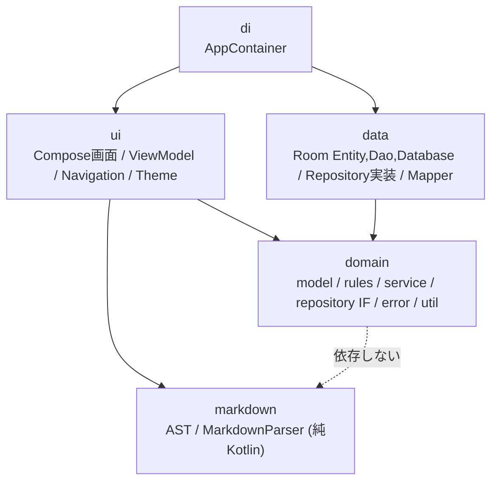
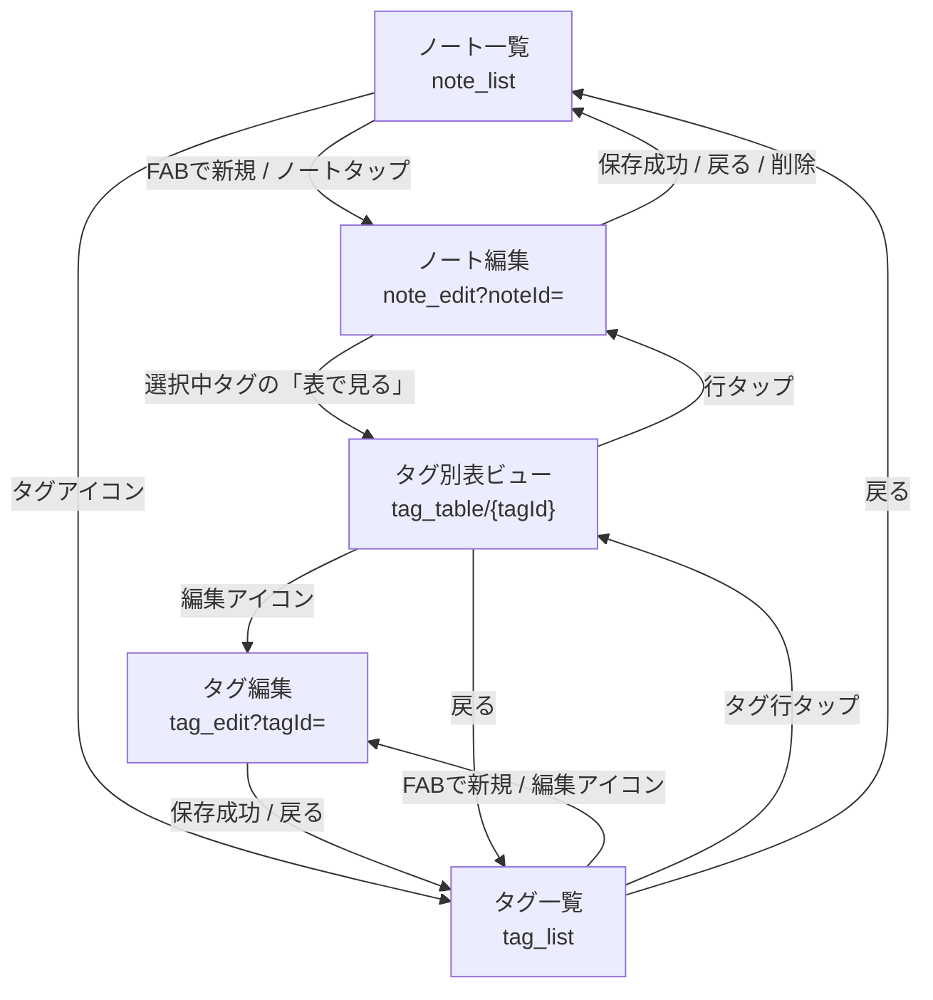

# アーキテクチャ設計

ステータス: 設計（未承認→親エージェントにより承認済み扱い）

関連: [requirements.md](requirements.md) / [data-model.md](data-model.md) / [testing.md](testing.md)

## 1. 層構造と依存方向



| 層 | パッケージ | 依存してよいもの | Android 依存 |
|---|---|---|---|
| domain | `com.amgm.notebook.domain` | Kotlin 標準, kotlinx-coroutines (Flow), `java.time` | なし |
| markdown | `com.amgm.notebook.markdown` | Kotlin 標準のみ | なし |
| data | `com.amgm.notebook.data` | domain, Room, coroutines | あり (Room) |
| ui | `com.amgm.notebook.ui` | domain, markdown, Compose, Navigation, Lifecycle | あり |
| di | `com.amgm.notebook.di` | 全層 | あり (Context) |

規則:
1. **ViewModel は `domain.repository` のインターフェースにのみ依存**し、`data` を import しない。
2. `domain` / `markdown` は `android.*` / `androidx.*` を import しない（`kotlinx.coroutines` は可）。
3. `data` は `ui` を import しない。`ui` は `data` を import しない。結線は `di` のみ。
4. 依存方向は単方向。逆流が必要な場合はインターフェースを domain に置く。

## 2. ファイル構成（固定）

ルート: `/` = リポジトリルート。モジュールは `app` 1つ。`<M>` = `app/src/main/java/com/amgm/notebook`。

```
settings.gradle.kts / build.gradle.kts / gradle/libs.versions.toml / gradle.properties
app/build.gradle.kts
app/src/main/AndroidManifest.xml            (INTERNET 権限なし)
app/src/main/res/values/strings.xml, themes.xml, ...
<M>/NotebookApplication.kt                  Application。container を保持
<M>/MainActivity.kt                         ComponentActivity。setContent { NotebookApp(container) }

<M>/domain/model/Ids.kt  PropertyType.kt  PropertyValue.kt  PropertyDefinition.kt  Tag.kt  Note.kt
<M>/domain/rules/TagHierarchy.kt  EffectivePropertyResolver.kt  NoteValidator.kt
<M>/domain/service/TableViewBuilder.kt
<M>/domain/repository/NoteRepository.kt  TagRepository.kt
<M>/domain/error/DomainExceptions.kt
<M>/domain/util/IdGenerator.kt             interface IdGenerator { fun newId(): String } + class UuidIdGenerator

<M>/markdown/MarkdownNode.kt  MarkdownParser.kt

<M>/data/db/NotebookDatabase.kt  NoteDao.kt  TagDao.kt
<M>/data/db/entity/NoteEntity.kt  TagEntity.kt  TagParentEntity.kt  NoteTagEntity.kt  TagPropertyDefinitionEntity.kt  NotePropertyEntity.kt  Relations.kt
<M>/data/mapper/EntityMappers.kt  PropertyValueCodec.kt
<M>/data/repository/RoomNoteRepository.kt  RoomTagRepository.kt

<M>/di/AppContainer.kt                      interface AppContainer + class DefaultAppContainer

<M>/ui/NotebookApp.kt                       @Composable fun NotebookApp(container: AppContainer)
<M>/ui/TestTags.kt
<M>/ui/common/UiEvent.kt  UiMessage.kt  ViewModelFactories.kt  PropertyInputs.kt  TagChips.kt
<M>/ui/navigation/Routes.kt  Destination.kt  NotebookNavHost.kt
<M>/ui/theme/Theme.kt  Color.kt  Type.kt
<M>/ui/markdown/MarkdownView.kt             MarkdownDocument を Compose で描画
<M>/ui/notelist/NoteListScreen.kt  NoteListViewModel.kt
<M>/ui/noteedit/NoteEditScreen.kt  NoteEditViewModel.kt
<M>/ui/taglist/TagListScreen.kt  TagListViewModel.kt
<M>/ui/tagedit/TagEditScreen.kt  TagEditViewModel.kt
<M>/ui/tagtable/TagTableScreen.kt  TagTableViewModel.kt
```

テスト配置は [testing.md](testing.md) 3 章。

## 3. 画面一覧

| 画面 | Composable | ViewModel | 目的 |
|---|---|---|---|
| ノート一覧 | `NoteListScreen` | `NoteListViewModel` | 検索・新規作成・タグ一覧への導線。FAB で新規。 |
| ノート編集 | `NoteEditScreen` | `NoteEditViewModel` | タイトル、タグ選択チップ、プロパティ編集、本文の編集/プレビュー切替。 |
| タグ一覧 | `TagListScreen` | `TagListViewModel` | タグ一覧（親タグ名・定義数）、新規/編集/削除、表ビューへ。 |
| タグ編集 | `TagEditScreen` | `TagEditViewModel` | 名前、親タグ複数選択、プロパティ定義編集（追加・型・必須・並べ替え・削除）、継承定義の読み取り表示。 |
| タグ別表ビュー | `TagTableScreen` | `TagTableViewModel` | タグ T の一員を表形式で一覧。列ソート。行タップでノート編集。 |

UI 方針: Material3 (`Scaffold`, `TopAppBar`, `FloatingActionButton`, `FilterChip`/`InputChip`, `OutlinedTextField`, `SegmentedButton` で編集/プレビュー切替, `AlertDialog`)。`Theme.kt` は Android 12 (API 31) 以上で `dynamicLightColorScheme` / `dynamicDarkColorScheme`、未満は `Color.kt` の固定配色。ダークは `isSystemInDarkTheme()` に追従。edge-to-edge 有効。表ビューは横スクロール可能で、タイトル列を固定表示する。

## 4. ナビゲーション

ルート文字列（`ui/navigation/Routes.kt`）:

| 定数 | ルート文字列 | 引数 |
|---|---|---|
| `Routes.NOTE_LIST` | `note_list`（開始地点） | なし |
| `Routes.NOTE_EDIT` | `note_edit?noteId={noteId}` | `noteId`: String, nullable, default null（null=新規） |
| `Routes.TAG_LIST` | `tag_list` | なし |
| `Routes.TAG_EDIT` | `tag_edit?tagId={tagId}` | `tagId`: String, nullable, default null（null=新規） |
| `Routes.TAG_TABLE` | `tag_table/{tagId}` | `tagId`: String（必須） |

引数キー定数: `Routes.ARG_NOTE_ID = "noteId"`, `Routes.ARG_TAG_ID = "tagId"`。ルート生成関数: `Routes.noteEdit(id: NoteId?)`, `Routes.tagEdit(id: TagId?)`, `Routes.tagTable(id: TagId)`。

遷移先の型（`ui/navigation/Destination.kt`、純Kotlinで JUnit から検証可能）:

```kotlin
sealed interface Destination {
    val route: String
    data object NoteList : Destination          // route = Routes.NOTE_LIST
    data class NoteEdit(val noteId: NoteId?) : Destination   // route = Routes.noteEdit(noteId)
    data object TagList : Destination
    data class TagEdit(val tagId: TagId?) : Destination
    data class TagTable(val tagId: TagId) : Destination
}
```

ViewModel は遷移を直接実行せず、`UiEvent` を一回限りのイベントとして発行する。Screen 側が `LaunchedEffect` でイベントを収集し `NavController` を操作する。これにより遷移を JUnit で検証できる。

```kotlin
// ui/common/UiEvent.kt
sealed interface UiEvent {
    data class Navigate(val destination: Destination) : UiEvent   // navController.navigate(destination.route)
    data object NavigateBack : UiEvent                            // navController.popBackStack()
    data class ShowMessage(val message: UiMessage) : UiEvent      // Snackbar
}
// ui/common/UiMessage.kt
enum class UiMessage { Saved, Deleted, SaveBlockedByErrors, CyclicInheritance, DuplicateTagName, TagNotFound, NameRequired }
```

各 ViewModel は `val events: Flow<UiEvent>`（内部は `Channel<UiEvent>(Channel.BUFFERED)` + `receiveAsFlow()`）を公開する。



注: 戻りは常に `popBackStack`（バックスタックの直前画面に戻る）。上図の戻り先は典型経路を示す。

## 5. ViewModel

共通規約:
- コンストラクタ引数は plain（`NoteId?` など）+ リポジトリインターフェース + `Clock` / `IdGenerator`。`SavedStateHandle` に依存しない（JUnit で素の `new` できるため）。
- `val uiState: StateFlow<XxxUiState>`（`stateIn(viewModelScope, SharingStarted.Eagerly, initial)` もしくは `MutableStateFlow` を `asStateFlow()`）。`val events: Flow<UiEvent>`。
- ユーザー操作は公開関数（`onXxx`）で受ける。関数は同期的に state を更新し、非同期処理は `viewModelScope.launch` で行う。
- ディスパッチャは `viewModelScope` 既定（Main）。テストは `Dispatchers.setMain(StandardTestDispatcher())` で差し替える。
- 生成は `ui/common/ViewModelFactories.kt` の Factory 関数（`ViewModelProvider.Factory`）で `AppContainer` から依存を渡す。`NotebookNavHost` が `backStackEntry.arguments` の引数を読んで Factory に渡し、`viewModel(key = route + 引数, factory = ...)` で生成する。

### 5.1 NoteListViewModel

コンストラクタ: `(noteRepository: NoteRepository, tagRepository: TagRepository)`

| UiState (`NoteListUiState`) | 型 | 説明 |
|---|---|---|
| `query` | `String` | 検索文字列 |
| `items` | `List<NoteListItem>` | `NoteListItem(id: NoteId, title: String, snippet: String, tagNames: List<String>, updatedAt: Instant)`。`title` が空なら UI で「(無題)」。`snippet` は本文先頭約80文字（Markdown記号除去しない） |
| `isLoading` | `Boolean` | 初回ロード完了まで true |

| 操作関数 | 動作 |
|---|---|
| `onQueryChange(query: String)` | `query` 更新。`observeNotes(query)` に切り替え（`flatMapLatest`）。 |
| `onNoteClick(id: NoteId)` | `Navigate(NoteEdit(id))` |
| `onCreateNoteClick()` | `Navigate(NoteEdit(null))` |
| `onTagsClick()` | `Navigate(TagList)` |
| `onDeleteNote(id: NoteId)` | `noteRepository.delete(id)` → `ShowMessage(Deleted)` |

### 5.2 NoteEditViewModel

コンストラクタ: `(noteId: NoteId?, noteRepository, tagRepository, idGenerator: IdGenerator, clock: Clock)`。`noteId == null` は新規（`idGenerator` で ID 採番、`createdAt = clock.instant()`）。存在しない `noteId` を渡された場合は新規扱いにせず、`notFound = true` を立てて `events` に `NavigateBack` を発行する。

| UiState (`NoteEditUiState`) | 型 | 説明 |
|---|---|---|
| `isNew` | `Boolean` | 新規か |
| `isLoading` | `Boolean` | 既存ノート読込中 |
| `title` | `String` | |
| `body` | `String` | Markdown ソース |
| `mode` | `EditorMode { Edit, Preview }` | 本文の編集/プレビュー |
| `previewDocument` | `MarkdownDocument` | `mode == Preview` のとき `MarkdownParser.parse(body)` の結果（Edit 中は直前値でよい） |
| `availableTags` | `List<Tag>` | 全タグ（名前順） |
| `selectedTagIds` | `Set<TagId>` | |
| `propertyRows` | `List<PropertyRowUi>` | 下記 |
| `issues` | `List<ValidationIssue>` | 最新の検証結果（常時再計算） |
| `isDirty` | `Boolean` | 保存済みから変更があるか |
| `isSaving` | `Boolean` | |
| `showDiscardDialog` | `Boolean` | 未保存で戻ろうとした時の確認 |
| `notFound` | `Boolean` | 指定IDが存在しない |

`PropertyRowUi(name: PropertyName, type: PropertyType, origin: PropertyOrigin, required: Boolean, input: String, value: PropertyValue, error: PropertyInputError?)`。`PropertyOrigin = Defined(definedBy: TagId) | Free`。`input` は入力欄の生文字列（Number/Date の編集中状態を保持）。`value` は `input` を型に従い解釈した結果で、解釈不能なら `Empty` かつ `error = Unparsable`。`PropertyInputError = Unparsable | TypeMismatch | RequiredMissing`。行の並びは「定義済み（実効定義順）→自由プロパティ（名前昇順）」。Boolean 型は `input` を `"true"`/`"false"`/`""` で持つ。Date 型の `input` は `yyyy-MM-dd`。

| 操作関数 | 動作 |
|---|---|
| `onTitleChange(title: String)` | title 更新、`isDirty = true` |
| `onBodyChange(body: String)` | body 更新、`isDirty = true` |
| `onModeChange(mode: EditorMode)` | モード切替。Preview に切替時に `previewDocument` 更新 |
| `onTagToggle(tagId: TagId)` | 選択トグル。`resolveForTags` で実効定義を再計算し `propertyRows` を再構成（既存値は保持、新しい定義は空で追加、定義が消えた行は自由プロパティ化）。再検証 |
| `onPropertyInputChange(name: PropertyName, input: String)` | 行の入力更新・解釈・再検証 |
| `onAddFreeProperty(name: String, type: PropertyType)` | 自由プロパティ追加。空名・既存名と重複は無視して `error` を行ではなく `ShowMessage(NameRequired)` |
| `onRemoveFreeProperty(name: PropertyName)` | 自由プロパティ行のみ削除可（定義済み行は値を空にするだけ） |
| `onTagTableClick(tagId: TagId)` | `Navigate(TagTable(tagId))` |
| `onSaveClick()` | 検証。ERROR あり→`ShowMessage(SaveBlockedByErrors)`、保存しない。ERROR なし→`noteRepository.save`（WARNING は `issues` に残す）→`ShowMessage(Saved)`→`NavigateBack` |
| `onBackClick()` | `isDirty` なら `showDiscardDialog = true`、でなければ `NavigateBack` |
| `onDiscardConfirm()` / `onDiscardDismiss()` | 破棄して `NavigateBack` / ダイアログを閉じる |
| `onDeleteClick()` | 既存ノートのみ。`delete` → `ShowMessage(Deleted)` → `NavigateBack` |

### 5.3 TagListViewModel

コンストラクタ: `(tagRepository: TagRepository)`

| UiState (`TagListUiState`) | 型 | 説明 |
|---|---|---|
| `items` | `List<TagListItem>` | `TagListItem(id: TagId, name: String, parentNames: List<String>, ownDefinitionCount: Int)` |
| `isLoading` | `Boolean` | |
| `pendingDelete` | `Tag?` | 削除確認ダイアログ対象 |

| 操作関数 | 動作 |
|---|---|
| `onTagClick(id: TagId)` | `Navigate(TagTable(id))` |
| `onEditTagClick(id: TagId)` | `Navigate(TagEdit(id))` |
| `onCreateTagClick()` | `Navigate(TagEdit(null))` |
| `onDeleteTagClick(id: TagId)` | `pendingDelete` を設定 |
| `onDeleteConfirm()` / `onDeleteDismiss()` | 削除実行（→`ShowMessage(Deleted)`）/ ダイアログを閉じる |
| `onBackClick()` | `NavigateBack` |

### 5.4 TagEditViewModel

コンストラクタ: `(tagId: TagId?, tagRepository: TagRepository, idGenerator: IdGenerator)`

| UiState (`TagEditUiState`) | 型 | 説明 |
|---|---|---|
| `isNew` | `Boolean` | |
| `isLoading` | `Boolean` | |
| `name` | `String` | |
| `parentCandidates` | `List<Tag>` | 親にできるタグ。**自分自身と自分の子孫を除外**（循環を UI で予防） |
| `selectedParentIds` | `Set<TagId>` | |
| `definitions` | `List<PropertyDefinitionDraft>` | `PropertyDefinitionDraft(name: String, type: PropertyType, required: Boolean)`。順序=定義順 |
| `inheritedSchema` | `EffectiveSchema` | 選択中の親から得る継承定義（読み取り専用表示）と衝突 |
| `error` | `TagEditError?` | `BlankName / DuplicateName / DuplicateDefinitionName(name) / BlankDefinitionName / Cyclic` |
| `isSaving` | `Boolean` | |

| 操作関数 | 動作 |
|---|---|
| `onNameChange(name: String)` | 更新・`error` クリア |
| `onParentToggle(id: TagId)` | 親の選択トグル。`inheritedSchema` 再計算 |
| `onAddDefinition()` | 空の定義（Text, required=false）を末尾追加 |
| `onDefinitionChange(index: Int, draft: PropertyDefinitionDraft)` | 更新 |
| `onRemoveDefinition(index: Int)` | 削除 |
| `onMoveDefinition(from: Int, to: Int)` | 並べ替え（定義順） |
| `onSaveClick()` | 画面内検証（名前空、定義名の空/重複）→`tagRepository.save`。`CyclicInheritanceException`→`error=Cyclic`+`ShowMessage(CyclicInheritance)`、`DuplicateTagNameException`→`error=DuplicateName`+`ShowMessage(DuplicateTagName)`。成功→`ShowMessage(Saved)`→`NavigateBack` |
| `onBackClick()` | `NavigateBack`（未保存確認は行わない） |

### 5.5 TagTableViewModel

コンストラクタ: `(tagId: TagId, tagRepository: TagRepository, noteRepository: NoteRepository, tableViewBuilder: TableViewBuilder = TableViewBuilder())`

動作: `tagRepository.observeTags()` と `TagHierarchy` から `descendantsOf(tagId) + tagId` を得て、`flatMapLatest { noteRepository.observeNotesByTagIds(it) }` と `combine` し、`TableViewBuilder.build` で `TableView` を作る。

| UiState (`TagTableUiState`) | 型 | 説明 |
|---|---|---|
| `isLoading` | `Boolean` | |
| `tagFound` | `Boolean` | 存在しないタグなら false（UI は戻る） |
| `tagName` | `String` | |
| `table` | `TableView?` | 列・行・衝突。データ未到着は null |
| `sort` | `TableSort?` | null=更新日時降順 |

| 操作関数 | 動作 |
|---|---|
| `onSortChange(key: TableSortKey)` | 同じ列なら昇順/降順トグル→（降順の次は解除=null）、別の列なら昇順で設定 |
| `onRowClick(noteId: NoteId)` | `Navigate(NoteEdit(noteId))` |
| `onEditTagClick()` | `Navigate(TagEdit(tagId))` |
| `onBackClick()` | `NavigateBack` |

## 6. DI（手動）: AppContainer

```kotlin
// di/AppContainer.kt
interface AppContainer {
    val noteRepository: NoteRepository
    val tagRepository: TagRepository
    val idGenerator: IdGenerator
    val clock: java.time.Clock
}

class DefaultAppContainer(
    database: NotebookDatabase,
    override val idGenerator: IdGenerator = UuidIdGenerator(),
    override val clock: Clock = Clock.systemUTC()
) : AppContainer {
    override val noteRepository: NoteRepository = RoomNoteRepository(database)
    override val tagRepository: TagRepository = RoomTagRepository(database)
    companion object { fun create(context: Context): DefaultAppContainer }   // NotebookDatabase.create(context) を使う
}
```

- `NotebookApplication.container: AppContainer` は `onCreate` で `DefaultAppContainer.create(this)`。
- `NotebookDatabase.create(context)` は `Room.databaseBuilder(..., "notebook.db")`、`NotebookDatabase.inMemory(context)` は `Room.inMemoryDatabaseBuilder`（androidTest 用）。
- `NotebookApp(container: AppContainer)` は `NotebookTheme { NotebookNavHost(container) }`。Compose UI テストは Activity に依存せず `composeRule.setContent { NotebookApp(DefaultAppContainer(NotebookDatabase.inMemory(ctx))) }` で起動する。
- ViewModel 用の `Factory` は `AppContainer` を受け取る。

## 7. ビルド構成（固定値）

CI が唯一の検証手段のため、相互互換が確認されている組み合わせに固定する。`gradle/libs.versions.toml` に定義:

| 項目 | バージョン |
|---|---|
| Gradle | 8.9 |
| JDK | 17 |
| Android Gradle Plugin | 8.7.3 |
| Kotlin | 2.0.21（`org.jetbrains.kotlin.android`, `org.jetbrains.kotlin.plugin.compose` 2.0.21） |
| KSP | 2.0.21-1.0.28 |
| Compose BOM | 2024.12.01 |
| Room | 2.6.1（`room-runtime`, `room-ktx`, `room-compiler` を ksp） |
| Navigation Compose | 2.8.5 |
| Lifecycle (viewmodel-compose, runtime-compose) | 2.8.7 |
| activity-compose | 1.9.3 |
| kotlinx-coroutines (core, test) | 1.9.0 |
| JUnit | 4.13.2 |
| androidx.test: runner / ext-junit / espresso-core | 1.6.2 / 1.2.1 / 3.6.1 |
| Compose UI test | `androidx.compose.ui:ui-test-junit4`（androidTest）, `ui-test-manifest`（debugImplementation）、BOM 管理 |

`app/build.gradle.kts` の要点: `namespace = "com.amgm.notebook"`, `applicationId = "com.amgm.notebook"`, `minSdk = 26`, `compileSdk = 35`, `targetSdk = 35`, `testInstrumentationRunner = "androidx.test.runner.AndroidJUnitRunner"`, `compileOptions`/`kotlinOptions` は Java 17、`ksp { arg("room.schemaLocation", "$projectDir/schemas") }`、`testOptions.unitTests.isReturnDefaultValues = true`、`buildFeatures.compose = true`。`sourceSets` に `src/sharedTest/java` を `test` と `androidTest` の両方へ追加（testing.md 参照）。`debug` ビルドを CI の成果物とする（署名不要）。

## 8. Markdown AST とパーサ（markdown）

ファイル: `markdown/MarkdownNode.kt`, `markdown/MarkdownParser.kt`。対応範囲は [requirements.md](requirements.md) 6 章。

```kotlin
data class MarkdownDocument(val blocks: List<MarkdownBlock>)

sealed interface MarkdownBlock {
    data class Heading(val level: Int /*1..3*/, val inlines: List<MarkdownInline>) : MarkdownBlock
    data class Paragraph(val inlines: List<MarkdownInline>) : MarkdownBlock
    data class CodeBlock(val language: String?, val code: String) : MarkdownBlock
    data class BulletList(val items: List<List<MarkdownInline>>) : MarkdownBlock
    data class OrderedList(val start: Int, val items: List<List<MarkdownInline>>) : MarkdownBlock
    data class Quote(val blocks: List<MarkdownBlock>) : MarkdownBlock
    data object ThematicBreak : MarkdownBlock
}

sealed interface MarkdownInline {
    data class Text(val text: String) : MarkdownInline
    data class Bold(val children: List<MarkdownInline>) : MarkdownInline
    data class Italic(val children: List<MarkdownInline>) : MarkdownInline
    data class Code(val text: String) : MarkdownInline
    data object LineBreak : MarkdownInline
}

object MarkdownParser { fun parse(source: String): MarkdownDocument }
```

ブロックの解析規則（行ベース、上から順に判定）:
1. 改行は `\r\n` / `\r` を `\n` に正規化。
2. 行頭が ``` ならコードブロック開始（残りは言語、空なら null）。次の ``` 行まで（閉じなければ末尾まで）を `code` とする（末尾の改行は含めない）。
3. `^#{1,3} +(.*)$` は Heading。`####` 以上や `#` の後にスペースが無いものは段落。
4. `^-{3,}\s*$` は ThematicBreak（ただし直前に段落行が連続していても setext 見出しにはしない）。
5. `> ` で始まる連続行は Quote。`> ` を取り除いた内容を再帰的に `parse` する（`>` のみの行は空行）。
6. `- ` で始まる連続行は BulletList（1行=1項目、インデントは無視、ネスト非対応）。
7. `^\d+\. ` で始まる連続行は OrderedList（`start` は最初の番号）。
8. 空行は区切り。
9. それ以外は Paragraph。連続する非空行を1段落にまとめ、行の境目は `LineBreak` とする。ただし次の行がブロック開始（2〜7）なら段落を終える。

インライン解析規則: `` ` `` で囲まれた範囲は `Code`（中身は解析しない）。`**…**` は `Bold`、`*…*` は `Italic`（相互にネスト可）。対応する閉じ記号が無い場合は記号を文字として `Text` に残す。バックスラッシュ `\` は直後の `*` `` ` `` `\` をエスケープ。リンク・画像・テーブル・HTML は特別扱いせず `Text`。パーサは例外を投げない（任意の入力で必ず `MarkdownDocument` を返す）。

描画 (`ui/markdown/MarkdownView.kt`): `@Composable fun MarkdownView(document: MarkdownDocument, modifier: Modifier)`。インラインは `AnnotatedString`（Bold=`FontWeight.Bold`, Italic=`FontStyle.Italic`, Code=等幅+背景色）。CodeBlock は等幅フォント・背景付きサーフェス・横スクロール。Quote は左線付き。

## 9. UI テスト用タグ（`ui/TestTags.kt`）

Compose の `Modifier.testTag` に使う定数。実機テストはこれで要素を特定する（文言変更に強くするため）。

| 定数 | 値 | 付ける要素 |
|---|---|---|
| `NOTE_LIST_FAB` | `note_list_fab` | ノート一覧の新規作成FAB |
| `NOTE_LIST_SEARCH` | `note_list_search` | 検索入力 |
| `NOTE_LIST_TAGS_BUTTON` | `note_list_tags_button` | タグ一覧へのボタン |
| `NOTE_LIST_ITEM_PREFIX` | `note_list_item_` | ノート行（末尾に `NoteId.value`） |
| `NOTE_EDIT_TITLE` | `note_edit_title` | タイトル入力 |
| `NOTE_EDIT_BODY` | `note_edit_body` | 本文入力 |
| `NOTE_EDIT_MODE_EDIT` / `NOTE_EDIT_MODE_PREVIEW` | `note_edit_mode_edit` / `note_edit_mode_preview` | 切替ボタン |
| `NOTE_EDIT_PREVIEW` | `note_edit_preview` | プレビュー領域 |
| `NOTE_EDIT_TAG_CHIP_PREFIX` | `note_edit_tag_chip_` | タグチップ（末尾に `TagId.value`） |
| `NOTE_EDIT_PROPERTY_PREFIX` | `note_edit_property_` | プロパティ入力（末尾に `PropertyName.value`） |
| `NOTE_EDIT_ADD_PROPERTY` | `note_edit_add_property` | 自由プロパティ追加ボタン |
| `NOTE_EDIT_SAVE` / `NOTE_EDIT_BACK` / `NOTE_EDIT_DELETE` | `note_edit_save` / `note_edit_back` / `note_edit_delete` | |
| `TAG_LIST_FAB` | `tag_list_fab` | タグ新規FAB |
| `TAG_LIST_ITEM_PREFIX` | `tag_list_item_` | タグ行（末尾に `TagId.value`） |
| `TAG_EDIT_NAME` | `tag_edit_name` | タグ名入力 |
| `TAG_EDIT_PARENT_CHIP_PREFIX` | `tag_edit_parent_chip_` | 親タグチップ（末尾に `TagId.value`） |
| `TAG_EDIT_ADD_DEFINITION` | `tag_edit_add_definition` | 定義追加ボタン |
| `TAG_EDIT_DEFINITION_NAME_PREFIX` | `tag_edit_definition_name_` | 定義名入力（末尾にindex） |
| `TAG_EDIT_SAVE` | `tag_edit_save` | |
| `TAG_TABLE` | `tag_table` | 表全体 |
| `TAG_TABLE_HEADER_PREFIX` | `tag_table_header_` | 列ヘッダ（`title` または `PropertyName.value`） |
| `TAG_TABLE_ROW_PREFIX` | `tag_table_row_` | 行（末尾に `NoteId.value`） |
