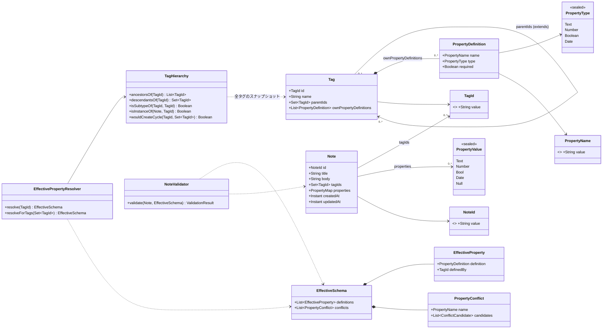
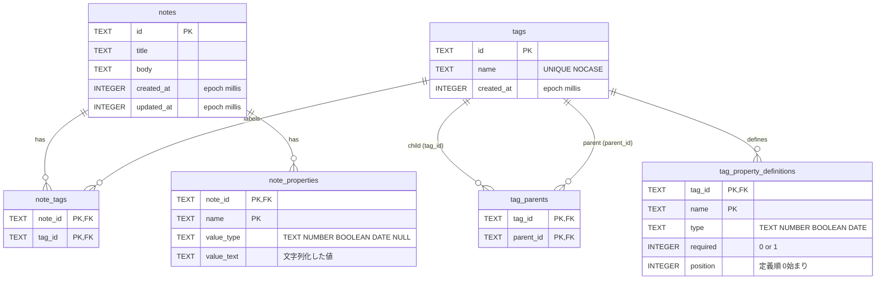

# データモデル設計

ステータス: 設計（未承認→親エージェントにより承認済み扱い）

関連: [requirements.md](requirements.md) / [architecture.md](architecture.md) / [testing.md](testing.md)

本書のコード風記述は Kotlin の擬似コードであり、シグネチャは固定、実装は後続担当が書く。パッケージはすべて `com.amgm.notebook` 配下。

## 1. 型定義（domain.model）

ファイル配置: `app/src/main/java/com/amgm/notebook/domain/model/`

```kotlin
// Ids.kt  — 公称型。生の String を直接渡さない。init で空白のみを拒否する(require)。
@JvmInline value class NoteId(val value: String)
@JvmInline value class TagId(val value: String)
@JvmInline value class PropertyName(val value: String)   // 生成時に trim 済みであること(require(value == value.trim() && value.isNotEmpty()))

// PropertyType.kt
sealed interface PropertyType {
    data object Text : PropertyType
    data object Number : PropertyType
    data object Boolean : PropertyType
    data object Date : PropertyType        // ISO-8601 LocalDate (yyyy-MM-dd)
}

// PropertyValue.kt
sealed interface PropertyValue {
    data class Text(val value: String) : PropertyValue
    data class Number(val value: Double) : PropertyValue    // init { require(value.isFinite()) }
    data class Bool(val value: Boolean) : PropertyValue
    data class Date(val value: java.time.LocalDate) : PropertyValue
    data object Null : PropertyValue        // 未設定(未入力)。Text("") とは別
}
// PropertyValue.matches(type: PropertyType): Boolean   … Null は常に true(型検証対象外)。Text("") は Text 型に一致

// PropertyDefinition.kt
data class PropertyDefinition(val name: PropertyName, val type: PropertyType, val required: Boolean)

// Tag.kt
data class Tag(
    val id: TagId,
    val name: String,                                   // 非空・trim済み。大文字小文字を区別せず一意
    val parentIds: Set<TagId>,                          // 複数親。自己参照不可
    val ownPropertyDefinitions: List<PropertyDefinition> // リスト順 = 定義順。同一タグ内で name 重複不可
)

// Note.kt
data class Note(
    val id: NoteId,
    val title: String,
    val body: String,                                   // Markdown ソース
    val tagIds: Set<TagId>,
    val properties: Map<PropertyName, PropertyValue>,   // 定義済み・自由の両方を含む
    val createdAt: java.time.Instant,                   // ミリ秒精度
    val updatedAt: java.time.Instant
)
```

`PropertyType` の永続化名（`type` / `value_type` 列）は `TEXT` / `NUMBER` / `BOOLEAN` / `DATE`、`PropertyValue` は加えて `NULL`（旧 `EMPTY` は読み込み時に Null 扱い）。

## 2. クラス図



注: `PropertyMap` は図示用の別名で、実体は `Map<PropertyName, PropertyValue>`（typealias は作らない）。

## 3. ドメインルール（rules）

ファイル配置: `domain/rules/TagHierarchy.kt`, `EffectivePropertyResolver.kt`, `NoteValidator.kt`（型 `EffectiveSchema` `EffectiveProperty` `PropertyConflict` `ConflictCandidate` `ValidationIssue` `ValidationResult` は同ファイル or 同パッケージ）。

### 3.1 識別子・名前

1. ID は `value class` で区別し、`NoteId` と `TagId` の取り違えをコンパイル時に検出する。生成は `IdGenerator`（`domain/util/IdGenerator.kt`）が UUID 文字列を返す。
2. `PropertyName` は trim 済みの非空文字列。比較は大文字小文字を区別する完全一致。
3. タグ名は trim 後に非空で、大文字小文字を区別せず一意（重複は `DuplicateTagNameException`）。

### 3.2 継承（TagHierarchy）

`TagHierarchy(tags: Map<TagId, Tag>)` は全タグのスナップショットから作る不変オブジェクト。

4. 継承は複数親を許す（DAG）。ダイヤモンド継承を許す。
5. 自己参照（`tag.id in tag.parentIds`）は登録時に拒否する。
6. 循環（祖先をたどると自分に戻る）は登録時に拒否する。拒否は `CyclicInheritanceException(tagId, path)`。判定は `wouldCreateCycle(tagId, newParentIds)`（新しい親の祖先に `tagId` が含まれるか、親が `tagId` 自身）。自己参照も同例外とする（`path = [tagId, tagId]`）。
7. 存在しない親IDを指定した保存は `TagNotFoundException(parentId)`。
8. `ancestorsOf(id)`: 全祖先（自身を含まない）を**線形化順**で返す。線形化は「親を名前（大文字小文字無視）→ID の昇順に並べ、各親について先に再帰して祖先を出力、その後に親自身を出力。既出タグは再出力しない（後順走査）」。結果は常に「祖先が子孫より前」になる（トポロジカル順）。親の保存順序は永続化しないため、この名前順が決定的な親順序である。
9. `descendantsOf(id)`: 全子孫（自身を含まない）の集合（推移閉包）。
10. `isSubtypeOf(sub, sup)`: `sub == sup` または `sup in ancestorsOf(sub)`。
11. タグ削除時: そのタグを親としていた子の `parentIds` からは除去される（子は孤児ではなく親が減るだけ）。ノートからはタグリンクが除去される。ノートのプロパティ値は自由プロパティとして残る。

### 3.3 一員判定（表ビューの対象）

12. `isInstanceOf(note, T)` = `note.tagIds.any { isSubtypeOf(it, T) }`。すなわちノートが T を持つ、または T の子孫タグを持つならノートは T の一員。
13. 表ビューの対象ノート集合 = `{ n | isInstanceOf(n, T) }`。リポジトリには `descendantsOf(T) + T` の集合を渡して `observeNotesByTagIds` で取得し、`TableViewBuilder` が 12 で再フィルタする（防御）。

### 3.4 実効プロパティ定義（EffectivePropertyResolver）

`resolve(tagId)` は `resolveForTags(setOf(tagId))` と同義。`resolveForTags(S)` は S の各タグと全祖先を対象にする（ノートに複数タグが付いた場合の定義集合もこれで得る）。

14. 対象タグ集合 `U` = S の各タグとその祖先の和集合。**走査順**は、S を（名前→ID昇順で）並べ、各タグについて 8 の線形化順（祖先→自身）で、既出を除いて連結した順序。
15. 各プロパティ名 n について、`U` 内で n を定義する（定義元タグ, 定義）の集合 `D(n)` を作る。
16. **子優先**: `D(n)` から、「別の要素の定義元が自分の定義元の厳密な子孫である」要素を除く（より具体的な定義が一般的な定義を上書きする）。残った極小要素の集合を `M(n)` とする。
17. `|M(n)| == 1` ならその定義を採用（型が親と違っても子が優先）。
18. `|M(n)| >= 2` で全ての型が同一なら統合する: 型は共通、`required` は論理和、`definedBy` は走査順で最初の定義元。
19. `|M(n)| >= 2` で型が異なるものを含むなら `PropertyConflict(n, candidates=[(tagId, type)...])` として検出して返す。この n は `definitions` に**含めない**（自由プロパティ扱いで型検証しない）。ノートのタグ自身が同名を再定義すれば 16 により子優先となり衝突は解消される。
20. `definitions` の順序 = 各名前が走査順で最初に現れた位置の昇順（上書きされても位置は最初の出現のまま）。同一タグ内は `ownPropertyDefinitions` のリスト順。これが表ビューの列順・ノート編集の入力欄順（定義済み分）になる。
21. 結果 `EffectiveSchema(definitions: List<EffectiveProperty>, conflicts: List<PropertyConflict>)`。`EffectiveProperty(definition, definedBy)`。

具体例:

```
Item        : { price: Number(required) }
Book        : Item        + { author: Text, isbn: Text }
Ebook       : Book        + { price: Text }        ← 子が型を変更 → 子優先
Gift        : { price: Date }
Hybrid      : Book, Gift                            ← price: Number(Item) と Date(Gift) → 型が異なり衝突
```

- `resolve(Book)` = `[price: Number(required, by Item), author, isbn]`
- `resolve(Ebook)` = `[price: Text (by Ebook, 位置は先頭のまま), author, isbn]`
- `resolve(Hybrid)`: `price` は M = {Item.price, Gift.price}（Item と Gift は無関係）、型が異なるので `PropertyConflict(price)`。`Hybrid` が自分で `price` を定義すれば解消。

### 3.5 検証（NoteValidator）

```kotlin
sealed interface ValidationIssue {
    val severity: Severity                // ERROR or WARNING
    data class TypeMismatch(val name: PropertyName, val expected: PropertyType, val actual: PropertyValue) : ValidationIssue   // ERROR
    data class RequiredMissing(val name: PropertyName) : ValidationIssue                                                        // WARNING
    data class Conflict(val conflict: PropertyConflict) : ValidationIssue                                                       // WARNING
}
data class ValidationResult(val issues: List<ValidationIssue>) {
    val errors get() = issues.filter { it.severity == Severity.ERROR }
    val warnings get() = issues.filter { it.severity == Severity.WARNING }
    val hasErrors get() = errors.isNotEmpty()
}
// fun NoteValidator.validate(note: Note, schema: EffectiveSchema): ValidationResult
```

22. `schema = resolveForTags(note.tagIds)`。
23. 定義済みプロパティ p について、値が存在し未入力(`Null`/空文字 Text)でなく、かつ型が一致しない場合は `TypeMismatch`（ERROR）。
24. 値が存在しない、`Null`、または `Text("")` で `p.required == true` の場合は `RequiredMissing`（WARNING）。
25. 衝突ごとに `Conflict`（WARNING）。
26. 自由プロパティ（定義のない名前）は型検証しない。
27. **保存方針（理由付き）**: `NoteRepository` は検証しない（データ層は永続化のみ）。`NoteEditViewModel` が保存前に検証し、**ERROR があれば保存を拒否**し、**WARNING のみなら保存して警告を UI に表示**する。理由: (a) 下書きの途中保存を妨げないため必須未入力は拒否しない、(b) 型不一致は復元時に値を解釈できず壊れたデータになりうるため拒否する、(c) UI は型付き入力欄なので ERROR は「自由プロパティが後から同名の別型定義を持つタグを付けた」場合などに限られる。
28. タグ付け替えで定義が変わっても既存の値は消さない。定義が消えた値は自由プロパティになり、型が合わなくなった値は ERROR として表示され、ユーザーが修正するまで保存できない。

## 4. 表ビュー（domain.service）

ファイル: `domain/service/TableViewBuilder.kt`

```kotlin
data class TableColumn(val name: PropertyName, val type: PropertyType, val required: Boolean)
data class TableRow(val noteId: NoteId, val title: String, val cells: List<PropertyValue>)  // cells は columns と同順・同数。値が無ければ Null
data class TableView(val tag: Tag, val columns: List<TableColumn>, val rows: List<TableRow>, val conflicts: List<PropertyConflict>)
data class TableSort(val column: TableSortKey, val ascending: Boolean)
sealed interface TableSortKey { data object Title : TableSortKey; data class Property(val name: PropertyName) : TableSortKey }

class TableViewBuilder {
    fun build(tagId: TagId, allTags: Map<TagId, Tag>, notes: List<Note>, sort: TableSort? = null): TableView
}
```

29. 列 = `resolve(tagId).definitions`（20 の順序）。タイトル列は常に先頭に別枠で表示する（`columns` には含めない）。
30. 行 = 13 の対象ノート。デフォルト順は `updatedAt` 降順。
31. セル = `note.properties[col.name]`。型が列の型と不一致でも `Null` として表示せず、そのまま値を持ち UI 側で警告アイコン（NoteValidator と同じ判定）。
32. ソート: `Null` は昇順・降順どちらでも末尾。`Text("")` は空文字として比較（`Null` と共に表示は空欄）。Text は大文字小文字無視の辞書順、Number は数値、Bool は false < true、Date は日付順。同値は `updatedAt` 降順で安定させる。

## 5. 永続化: Room スキーマ（data）

ER 図:



テーブル仕様（Room Entity クラスはカッコ内。ファイルは `data/db/entity/`）:

| テーブル (Entity) | 主キー | 外部キー | インデックス |
|---|---|---|---|
| `notes` (`NoteEntity`) | `id` | なし | `updated_at` |
| `tags` (`TagEntity`) | `id` | なし | `name` UNIQUE（`COLLATE NOCASE`） |
| `tag_parents` (`TagParentEntity`) | (`tag_id`,`parent_id`) | 両方 `tags(id)` ON DELETE CASCADE | `parent_id` |
| `note_tags` (`NoteTagEntity`) | (`note_id`,`tag_id`) | `notes(id)` / `tags(id)` ON DELETE CASCADE | `tag_id` |
| `tag_property_definitions` (`TagPropertyDefinitionEntity`) | (`tag_id`,`name`) | `tags(id)` CASCADE | なし |
| `note_properties` (`NotePropertyEntity`) | (`note_id`,`name`) | `notes(id)` CASCADE | なし |

33. 値の符号化（`data/mapper/PropertyValueCodec.kt`、純Kotlin）: Text=そのまま / Number=`Double.toString()`（復元は `toDouble()`） / Boolean=`"true"`/`"false"` / Date=`LocalDate.toString()`（ISO-8601、復元は `LocalDate.parse`） / Null=`value_type "NULL"`・`value_text ""`（列は NOT NULL のまま。`Text("")` は `TEXT` + `""` で区別）。`value_type` で復元する。未知の `value_type` や復元失敗は `Null` にフォールバックする（クラッシュさせない）。
34. 日時は `Instant.toEpochMilli()` で保存、`Instant.ofEpochMilli()` で復元。
35. `tag_parents` に順序列は持たない。親の順序は 8 の名前順で決定的に扱う。
36. データベース: `NotebookDatabase`（version = 1, `exportSchema = true`, スキーマ出力先 `app/schemas`）、DB ファイル名 `notebook.db`。`PRAGMA foreign_keys=ON` は Room が既定で有効化する。
37. 書き込みは `@Transaction`。`TagDao.replaceTag` は「tags upsert → tag_parents 全削除→挿入 → tag_property_definitions 全削除→挿入」を1トランザクションで行う。`NoteDao.replaceNote` も同様に note_tags / note_properties を入れ替える。
38. 循環検出は `RoomTagRepository.save` が `database.withTransaction` 内で全タグを読み、候補を適用した `TagHierarchy` で検証してから書く（検証と書き込みの間に他の書き込みを挟まない）。

## 6. リポジトリインターフェース（domain.repository）

ファイル: `domain/repository/NoteRepository.kt`, `TagRepository.kt`

```kotlin
interface NoteRepository {
    fun observeNotes(query: String = ""): Flow<List<Note>>          // updatedAt 降順。query は title/body の部分一致(大文字小文字無視)。空文字は全件
    fun observeNote(id: NoteId): Flow<Note?>
    suspend fun getNote(id: NoteId): Note?
    fun observeNotesByTagIds(tagIds: Set<TagId>): Flow<List<Note>>  // いずれかのタグが付いたノート。空集合なら空リスト
    suspend fun save(note: Note)                                    // 新規/更新(upsert)。未知の TagId は TagNotFoundException
    suspend fun delete(id: NoteId)                                  // 存在しなくても何もしない
}

interface TagRepository {
    fun observeTags(): Flow<List<Tag>>                              // 名前の昇順(大文字小文字無視)
    fun observeTag(id: TagId): Flow<Tag?>
    suspend fun getTag(id: TagId): Tag?
    suspend fun getAllTags(): List<Tag>
    suspend fun save(tag: Tag)                                      // CyclicInheritanceException / DuplicateTagNameException / TagNotFoundException
    suspend fun delete(id: TagId)                                   // 存在しなくても何もしない
}
```

例外クラスは `domain/error/DomainExceptions.kt`（すべて `RuntimeException` 継承）: `CyclicInheritanceException(tagId, path: List<TagId>)`, `DuplicateTagNameException(name)`, `TagNotFoundException(tagId)`。

`Note.updatedAt` の更新は ViewModel が `Clock` から設定する（リポジトリは渡された値を保存する）。

## 付録 v2: 追加モデル

- **Note.autoSyncTitleH1: Boolean = true** … 本文の最初の h1 とタイトルを同期するか。`notes.auto_sync_title_h1 INTEGER NOT NULL DEFAULT 1`。同期ロジックは純粋関数 `TitleHeadingSync`（`initialBody` / `syncFirstH1`。"# " 始まりの最初の行のみ対象で `##` とコードブロック内は無視、CRLF/LF 両対応、h1 が無ければ先頭に挿入、空白のみのタイトルでは本文不変）。
- **PropertyType.NoteLink(targetTagId: TagId?)** … 他ノートへのリンク（複数可）。`type` 列は `NOTE_LINK`、対象タグは `tag_property_definitions.link_target_tag_id TEXT NULL`（外部キーなし。対象タグが存在しなければ読み出し時に null 扱い）。
- **PropertyValue.NoteRefs(ids: List<NoteId>)** … 順序保持・重複なし（`NoteRefs.of` で重複除去、コンストラクタは重複と空リストを拒否）。ID にカンマ不可。`value_type = NOTE_REFS`、`value_text` はカンマ区切りの NoteId。空リストは作れず `PropertyValue.ofNoteRefs(ids)` で `Null` に正規化（保存も Null）。`matches`: NoteLink 型には NoteRefs と Null のみ一致。
- **検証** … NoteLink 定義に NoteRefs 以外は `TypeMismatch`（ERROR）、必須未入力は従来どおり `RequiredMissing`（WARNING）。参照先の存在は検査しない。
- **継承の解決** … 同名で NoteLink 同士は `targetTagId` が違っても衝突としない。子優先で残った定義のうち対象タグを持つ最初のものを採用する。
- **TagTree** … `flattenTagTree(tags)`（`domain/service/TagTree.kt`）。`TagTreeNode(tag, depth, isAdditionalParentOccurrence)`。
- **Migration 1 -> 2** … `ALTER TABLE notes ADD COLUMN auto_sync_title_h1 INTEGER NOT NULL DEFAULT 1` と `ALTER TABLE tag_property_definitions ADD COLUMN link_target_tag_id TEXT`。DB version = 2。

## 値の状態（null と空文字列）

- 未設定 = `PropertyValue.Null`。タグを付けただけのプロパティ値はこの状態（`NotePropertyRules.onTagsAdded`）。
- 編集して内容が空になった文字列型の値 = `PropertyValue.Text("")`。`Null` とは別の状態で、永続化でも `NULL` / `TEXT`+`""` として区別する。
- `Null` と `Text("")` はどちらも「未入力」: 必須判定は `RequiredMissing`、表ビューは空欄表示（`PropertyValue.isUnset`）。ソートでは `Null` が昇順・降順とも末尾、`Text("")` は空文字として比較する。
- `NoteLink` の空は `Null`（`NoteRefs` は非空のみ。`PropertyValue.ofNoteRefs(ids)` が空を `Null` に正規化）。

## タグ取り外し時の規則

`domain/rules/NotePropertyRules.kt`:

- `onTagsAdded(note, allTagsAfter, addedTagIds)`: 追加タグの実効定義のうち `note.properties` に無い名前を `Null` で追加。既存値は変更しない。
- `onTagsRemoved(properties, remainingTagIds, removedTagIds, allTags)`: `allTags` は取り外し前を含む。取り外し前の実効定義（残り+外す）にあり、残りの実効定義（衝突中の名前を含む）に無い名前が対象。対象のうち値が `Null` は削除、それ以外（`Text("")` を含む文字列・Number/Boolean/Date/NoteRefs の非 null 値）は自由プロパティとして残す。残ったタグが定義する名前（多段継承で親が残る場合を含む）と、元からの自由プロパティは変更しない。
