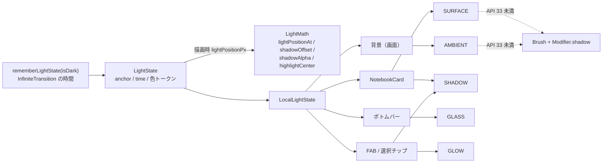

# 光と影（シェーダー基盤）

ステータス: 基盤とコンポーネントを実装。ルートへの組み込み済み。全画面への適用は §9（実機の見た目の確認は CI のスクリーンショットで行う）

関連: [architecture.md](architecture.md)（テーマ・コンポーネント） / [testing.md](testing.md)

コードは `app/src/main/java/com/amgm/notebook/ui/lighting/` にある。色トークンは `ui/theme/Color.kt` の「光」節。

## 1. コンセプト

画面全体に光源は 1 つだけ。影は必ず光源と反対方向に落ち、すべてのコンポーネントで向きが揃う。

| | ライト「窓辺の朝の光」 | ダーク「夜の卓上灯」 |
|---|---|---|
| 光源の位置（画面に対する正規化座標） | `(-0.15, -0.20)`。左上の画面外 | `(0.5, -0.25)`。上部中央の画面外 |
| 背景 | 紙色（`#F6F5F1`）より明るい暖白（`#FFF8EA`）の光が左上から差す。窓の光（2 枚）に木漏れ日のゆらぎ。端はごく弱く暖色に沈む。粒状感 ±0.010 | インク `#121317` の地に、上部中央の卓上灯の溜まり。四隅は最大 25% 沈む。粒状感 ±0.012 |
| カード | 暖白の面（`#FFFDF8`）に光源方向の線形グラデーション。光源側の縁に白の 1.2px のベベル | インク寄りのスレート（`#23252E`）。上縁に暖白のリム。押下でテアルのグローが広がる |
| 影 | 暖かい茶インク `#3A3226` の 2 層（接地影と、光源と反対へ伸びる環境影） | 黒の 2 層を、より濃く |

## 2. 光源モデル

- `LightState`（`LightState.kt`）が光源を表す。`rememberLightState(isDark)` で作り、`LocalLightState` で配下へ渡す（画面の入口で 1 回）。
- 色は `Color.kt` の色トークンから作る。コンポーネントは色を直接書かず `LightState` の `keyColor` / `baseColor` / `shadowColor` / `highlightColor` / `rimColor` / `glowColor` を使う。
- **位置の漂い**: `lightPositionPx(screenSize)` が `lightPositionAt` で光源を動かす。中心は anchor、横半径は画面幅 × 0.06、縦はその 0.6 倍の楕円を **周期 28 秒** で回る。
- **色の約束**: ライトの光源色は紙色より明るい（光の当たる側は必ずベース以上の明るさ）。ダークの地はインクの `#121317` で、茶色には寄せない。
- **時間ループ**: `rememberInfiniteTransition` で 0 → `LOOP_SECONDS`（3584 秒）を線形に繰り返す。自前の `withFrameNanos` ループは使わない（Compose の UI テストが無限アニメーションを止められなくなるため）。
- **ループ長を 3584 秒にする理由**: 光源の周期 28 秒で割り切れる長さにするため（3584 = 28 × 128）。仕様の 3600 秒だと 28 秒の周期と合わず、1 時間ごとに光源が跳ぶ。脈動（7 秒）・きらめき（14 秒）も 3584 の約数で、ループの折り返しで跳ばない。新しい周期を追加するときは 3584 の約数にすること（7, 14, 28, 56, 64, 112, 128, 224, 256, 448, 512, 896, 1792）。
- **モーション低減**: `Settings.Global.ANIMATOR_DURATION_SCALE == 0` のとき `motionEnabled = false`。時間は 0 扱いになり、光も木漏れ日も静止する。
- **描画フェーズでのみ時間を読む**: `time.value` は `drawBehind` / `drawWithCache` の描画処理の中で読む。コンポジション中に読むと、毎フレームの再コンポーズが起きる。

## 3. 影の規則

- `shadowOffset(lightPos, elementCenter, elevationPx, maxOffsetPx)`: 光源から要素中心へ向かう単位ベクトル × `elevationPx × 0.9`（`maxOffsetPx` で頭打ち）。光源と中心が一致したら真下へ `elevationPx × 0.25`。
- `shadowAlpha(elevationDp, isDark)`: 環境影の不透明度。ライト `0.06 + elevation × 0.0117`（上限 0.13）、ダーク `0.30 + elevation × 0.025`（上限 0.45）。
- `contactShadowAlpha(ambientAlpha)`: 接地影の不透明度。環境影の 0.65 倍（上限 1）。
- `highlightCenter(lightPos, elementTopLeft, elementSize)`: 要素ローカル座標で、要素中心から光源方向へ半サイズ × 0.6 寄せた点。`SURFACE` のスペキュラ中心と同じ式。

## 4. シェーダー 5 種

ソースは `NotebookShaders.kt` の `ShaderSpec`。すべて AGSL で、`half4 main(float2 fragCoord)` の 1 関数。返す色は乗算済みアルファ。

| 名前 | 役割 | 描画範囲 | uniform（型・個数） |
|---|---|---|---|
| `AMBIENT`（ambient） | 全画面の背景。ライトは暖白の光の減衰と窓の光 2 枚（枚幅 0.24W・高さ 0.50H・間隔 0.04W、-28° 回転・0.16 せん断の平行四辺形。窓の内側は暖白へ 11%、外側は 0.12W の範囲に +2% から 0 のハロー）、窓の中だけに 2 層 value noise（W/4 と W/9）の木漏れ日（窓の内側の強さを 0.55〜1.0 倍。周期 112・224 秒で漂う。時刻 0 でも模様が出る）、ダークは上部中央の卓上灯の溜まりと寒色のフィル。ビネット、静的ハッシュの粒状感 | 画面全体 | `iResolution`(float2), `iTime`(float), `uLightPos`(float2, px), `uBaseColor`(float4), `uKeyColor`(float4), `uShadowColor`(float4), `uIntensity`(float), `uGrain`(float), `uDark`(float, 0 or 1) |
| `SURFACE`（surface） | カードの面。角丸 SDF マスク、光源方向に沿った面の色、柔らかなスペキュラ、縁の 1.2px のベベル（SDF の勾配と光源方向の内積で切り替え）、押下点からの放射グロー | 要素 | `iResolution`(float2, 要素サイズ), `uLightPos`(float2, 要素ローカル。要素外可), `uBaseColor`(float4), `uHighlightColor`(float4), `uRimColor`(float4), `uRadius`(float), `uPress`(float, 0..1), `uPressPos`(float2), `uPressColor`(float4), `uDark`(float, 0 or 1), `iTime`(float) |
| `SHADOW`（shadow） | 柔らかい影。ずらした影の矩形の SDF からの指数減衰。乗算済み。要素本体（ずらす前の矩形）の内側だけを抜く（縁は 1.5px でアンチエイリアス）。本体を抜かないと、ずらした影が本体の直下で透けて二重の縁に見える | 影の描画領域（ぼかし幅ぶん大きく） | `iResolution`(float2), `uRectCenter`(float2), `uRectSize`(float2), `uRadius`(float), `uBlur`(float), `uShadowColor`(float4), `uCasterCenter`(float2, 描画枠の座標), `uCasterSize`(float2), `uCasterRadius`(float) |
| `GLASS`（glass） | 半透明の板（ボトムバー等）。上辺の 1px の光の線を板の上に over 合成、光源側のゆるいグラデーション（4%）、ごく弱いノイズ。背景のぼかしはしない | 要素 | `iResolution`(float2), `uTint`(float4), `uHighlightColor`(float4), `uLightPos`(float2, 要素ローカル), `uRadius`(float), `iTime`(float) |
| `GLOW`（glow） | FAB や選択要素の後光。形の内側は描かず、外側へ指数減衰。周期 7 秒で ±10% 脈動 | 要素の外側まで広く | `iResolution`(float2), `uRectCenter`(float2), `uRectSize`(float2), `uRadius`(float), `uGlowColor`(float4), `uSpread`(float), `iTime`(float) |

- `SHADOW` と `GLOW` は描画領域の端 2px で光・影をフェードする（切り口が見えないように）。描画領域は十分な余白を取ること。
- 宣言した uniform は必ず main から使う。未使用の uniform は `setFloatUniform` が失敗するため、テストで検出する。
- AGSL の制約: `texture` / `uniform shader` は使わない。for ループは定数境界のみ。整数リテラルを float に入れない（`1.0` と書く）。

## 5. API 33 未満のフォールバック

`ShaderSupport.isRuntimeShaderSupported`（`Build.VERSION.SDK_INT >= TIRAMISU`）で分岐する。`rememberRuntimeShader` と `RuntimeShader.setUniform` は true の分岐の中でだけ呼ぶ。

| 効果 | API 33 以上 | API 26〜32 |
|---|---|---|
| 背景の光 | `AMBIENT` | `Brush.radialGradient`（光源位置に中心）＋ 暖白（ダークは卓上灯）の半透明、下端の弱い影 |
| カードの面・リム | `SURFACE` | `Brush.linearGradient`（光源側の明るみ、反対側の沈み）＋ 光源側の縁の 1dp の線 |
| 影 | `SHADOW` | `Modifier.shadow`（`shadowAlpha` の値と `shadowOffset` のずれを elevation に反映） |
| 板の光の線 | `GLASS` | 板の色（ライト白 0.72 / ダーク `#1C1E25` 0.78）と上辺の 1dp の線 |
| 後光 | `GLOW` | `Modifier.shadow` の `ambientColor` / `spotColor` に `glowColor` |

フォールバックでも光源の向きは同じ（左上から右下）に揃える。

## 6. コンポーネント

`ui/lighting/` の 5 つの部品。画面の入口で `LocalLightState` を渡し、各部品は `LightState` から色と光源位置を読む。

| 部品 | ファイル | 役割 | API 26〜32 |
|---|---|---|---|
| `AmbientLightBackground(modifier, content)` | `AmbientLightBackground.kt` | 画面の背面に `AMBIENT` を全面描画し、その上に `content`。`NotebookApp` が画面全体を包む | 紙色 + 光源位置を中心とする放射グラデーション + 下端の弱い影 |
| `Modifier.softShadow(cornerRadius, elevation)` | `SoftShadow.kt` | 2 層の `SHADOW`。接地影（ぼかし 1.5dp + elevation × 0.35、ずれ 0.25 倍、不透明度 0.65 倍）と環境影（ぼかし elevation × 3.0、光源と反対へ elevation × 0.9 ずらす）。要素の外へはみ出して描く。要素本体（ずらす前）の位置・サイズ・角丸を `uCaster*` で渡し、本体の内側を抜く | `Modifier.shadow`（`ambientColor` / `spotColor` に影色） |
| `Modifier.litSurface(cornerRadius, baseColor, interactionSource?)` | `LitSurface.kt` | `SURFACE` で面を描く。押下点から光が広がり、離すと 220ms で消える。`baseColor` の既定はカードの `surface`（ライト `#FFFDF8`、ダーク `#23252E`） | 色の塗り + 光源側の明るみ・反対側の沈み + 光源側の縁の 1dp の線 |
| `Modifier.glassPanel(cornerRadius)` | `GlassPanel.kt` | `GLASS` で半透明の板を描く（ライト白 0.72、ダーク `#1C1E25` 0.78）。上辺の線はライト白 0.95、ダーク暖白 0.25。ボトムバー用 | 板の色の半透明 + 上辺の 1dp の線 |
| `GlowFab(text, icon, onClick, modifier)` | `GlowFab.kt` | 拡張 FAB の背後に `GLOW`（広がり 24dp、色 `glowColor`、不透明度 0.45）。`modifier`（testTag を含む）は FAB 本体へ渡す | `Modifier.shadow` の `spotColor` を `glowColor` にする |

共通の約束:

- 光源の位置・時間・押下の状態は**描画フェーズ（`drawBehind`）でだけ読む**。再コンポーズを起こさない。要素の画面上の矩形は `onGloballyPositioned` で `State` に保存し、描画で読む（`rememberRootBounds` / `trackRootBounds`）。
- 影と後光は要素の外側へ描く。描画枠は「要素 + 拡張量」（`shadowExpansion` / `glowExpansion` / `shaderFrame`）で、`translate` で枠の原点へ移してからシェーダーを描く。拡張量はぼかし幅の 3 倍（後光は広がりの 4 倍）。
- シェーダーの uniform は要素ごと・層ごとに `remember` した `RuntimeShader` に、描画のたびに設定する。
- 光源座標は画面サイズ（`LocalConfiguration` × 密度）を基準にし、要素は root 座標で測る。ステータスバー等の分だけ方向がずれうるが、影の向きに目立つ差は出ない想定。
- モーション低減のときは `shaderTimeSec()` が 0 を返し、木漏れ日・脈動・きらめきが止まる。

### 画面への適用

適用の一覧と elevation の規則は §9。6 つの画面の `Scaffold` の `containerColor` は `Color.Transparent` にしてある。

## 7. 関係図

コンポーネントは `ui/lighting/` の部品（§6）として実装済み。ルートは `NotebookApp` が `LocalLightState` を渡し、背景を `AmbientLightBackground` で包む。

## 8. テスト

| 種類 | ファイル | 内容 |
|---|---|---|
| JVM 単体 | `app/src/test/.../ui/lighting/LightMathTest.kt` | 周期で元に戻る・`periodSec <= 0` で anchor、影の方向・長さ・頭打ち・一致時の既定値、影の不透明度の上限（ライト/ダーク）、スペキュラ中心の寄り方、色の RGBA 取り出し（非乗算） |
| JVM 単体 | `app/src/test/.../ui/lighting/LightComponentMathTest.kt` | 要素ローカルへの変換、影・後光の拡張量、描画枠の大きさと形の中心（ずれあり/なし）、影の本体（caster）の中心（拡張量に依らず要素中心へ戻る。影のずれで動かない）、接地影の不透明度 |
| JVM 静的検査 | `app/src/test/.../ui/lighting/ShaderSpecLintTest.kt` | 全 `ShaderSpec` について、`half4 main(float2` の存在、uniform の宣言と仕様の双方向の一致、宣言以外での使用、`floatCount` と宣言型の一致、`texture` / `uniform shader` の禁止、波括弧の対応、定数境界の for ループ、名前の重複なし。SHADOW の uniform 一覧（本体の 3 つを含む） |
| 実機（API 33 以上） | `app/src/androidTest/.../ui/lighting/ShaderCompileTest.kt` | 全シェーダーを `RuntimeShader` でコンパイルし、全 uniform に `floatCount` 個の値を設定できること。失敗メッセージにシェーダー名と uniform 名を含む |

この環境ではコンパイルできないため、AGSL の文法は CI の実機テストで確かめる。JVM 側の静的検査は、CI より前に uniform の食い違いを検出するためにある。

## 9. 画面への適用

全画面に、部品（§6）を次のとおり適用している。影の強さは `NotebookDimens`（`ui/theme/Dimens.kt`）の定数を使う。

| 画面 | 対象 | 使った部品 | elevation |
|---|---|---|---|
| 全画面 | 背景 | `AmbientLightBackground`（`NotebookApp`） | - |
| ノート一覧 | 「新規ノート」FAB | `GlowFab`（testTag `NOTE_LIST_FAB`） | FAB の既定 |
| ノート一覧 | ノートの行 | `NotebookCard`（既定） | 3dp |
| ノート編集 | 上部バー（戻る・保存） | `glassPanel` | - |
| ノート編集 | 見出し同期の行 | `softShadow` + `litSurface` | 3dp |
| ノート編集 | 「プロパティ」「本文」カード | `NotebookCard` | 6dp |
| ノート編集 | ノート紐付けピッカー | シートは透明、中身に `glassPanel` | - |
| タグ一覧 | タグの行（1 件ごと。ネストのガイド線は残す） | `NotebookCard` | 3dp |
| タグ一覧 | 「新規タグ」FAB | `GlowFab`（testTag `TAG_LIST_FAB`） | FAB の既定 |
| タグ編集 | 上部バー（戻る・保存） | `glassPanel` | - |
| タグ編集 | 「名前」「親タグ」「継承」「プロパティ定義」カード | `NotebookCard` | 6dp |
| 表タブ | タグごとのカード | `NotebookCard` | 3dp |
| タグ別表 | 上部バー（戻る・編集） | `glassPanel` | - |
| タグ別表 | 表全体（1 枚のカード） | `softShadow` + `litSurface` | 6dp |
| タグ別表 | 「ノートを追加」FAB | `GlowFab`（testTag `TAG_TABLE_ADD_NOTE`） | FAB の既定 |
| 全画面 | ボトムバー | `softShadow` + `glassPanel`（testTag `BOTTOM_NAV` は外側のコンテナ） | 12dp |
| 全画面 | 入力欄の塗り（`notebookFieldColors`） | 面色の半透明（ライト 0.7、ダーク 0.5） | - |
| 全画面 | 選択中のタグチップ | `softShadow`（選択中だけ） | 2dp |
| 全画面 | 大見出し（`LargeTitleHeader`） | 文字の `Brush`（ライト: 主色をわずかに明るく、ダーク: 白から `rimColor`） | - |

### elevation の規則

- 主要カード（画面の主題になる大きなカード）は `NotebookDimens.MainElevation`（6dp）。
- 行・小カード（一覧の行、タグのカード）は `NotebookDimens.RowElevation`（3dp）。`NotebookCard` の既定値。
- 浮遊する板（ボトムバー）は 12dp。FAB は `GlowFab`（Material の 2dp と後光）。
- 選択チップは 2dp。影は弱く、選択中だけ付ける。

### 面の作り方の約束

- 光る面は**不透明な地を持たせない**。表のように内容が重なる場所だけ、地を不透明にする（横スクロールで流れてくる固定列など）。
- 状態を伝える注記（型の衝突、必須の警告、エラー）は、状態の色（`tertiaryContainer` / `errorContainer`）を保つため光の面にしていない。
- ライトのヘッダー行は、カードの白より明るくできない（白が最も明るい）ため、`surfaceVariant` の帯で区別する。
- 補助文字の色は変えていない。ライトの `TextSubLight` は紙色の上で約 4.65:1、白で約 5.08:1、ダークの `TextSubDark` は約 6.5〜7.3:1で、通常の本文として AA（4.5:1）を満たす。
