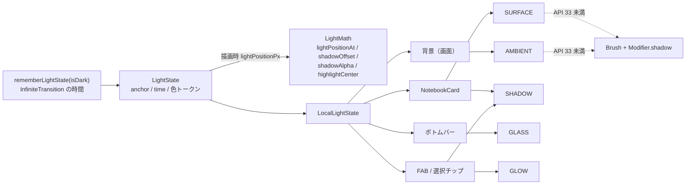

# 光と影（シェーダー基盤）

ステータス: 設計（基盤のみ実装。コンポーネントや画面への適用は後続）

関連: [architecture.md](architecture.md)（テーマ・コンポーネント） / [testing.md](testing.md)

コードは `app/src/main/java/com/amgm/notebook/ui/lighting/` にある。色トークンは `ui/theme/Color.kt` の「光」節。

## 1. コンセプト

画面全体に光源は 1 つだけ。影は必ず光源と反対方向に落ち、すべてのコンポーネントで向きが揃う。

| | ライト「窓辺の朝の光」 | ダーク「夜の卓上灯」 |
|---|---|---|
| 光源の位置（画面に対する正規化座標） | `(-0.15, -0.20)`。左上の画面外 | `(0.5, -0.25)`。上部中央の画面外 |
| 背景 | 紙色の上に、右下へ差す暖色の光。木漏れ日のような低コントラストのゆらぎ。紙の粒状感 | 深いインク色に沈み、上部に暖色の灯りの溜まり。画面端は強いビネット |
| カード | 面に柔らかなスペキュラ。縁は光源側にだけ細く光る（白） | 縁に淡い青白のリムライト。テアルのアクセントがかすかに発光 |
| 影 | インクの影色 `#1B1C22` を薄く | 黒を、より濃く |

## 2. 光源モデル

- `LightState`（`LightState.kt`）が光源を表す。`rememberLightState(isDark)` で作り、`LocalLightState` で配下へ渡す（画面の入口で 1 回）。
- 色は `Color.kt` の色トークンから作る。コンポーネントは色を直接書かず `LightState` の `keyColor` / `baseColor` / `shadowColor` / `highlightColor` / `rimColor` / `glowColor` を使う。
- **位置の漂い**: `lightPositionPx(screenSize)` が `lightPositionAt` で光源を動かす。中心は anchor、横半径は画面幅 × 0.06、縦はその 0.6 倍の楕円を **周期 28 秒** で回る。
- **時間ループ**: `rememberInfiniteTransition` で 0 → `LOOP_SECONDS`（3584 秒）を線形に繰り返す。自前の `withFrameNanos` ループは使わない（Compose の UI テストが無限アニメーションを止められなくなるため）。
- **ループ長を 3584 秒にする理由**: 光源の周期 28 秒で割り切れる長さにするため（3584 = 28 × 128）。仕様の 3600 秒だと 28 秒の周期と合わず、1 時間ごとに光源が跳ぶ。脈動（7 秒）・きらめき（14 秒）も 3584 の約数で、ループの折り返しで跳ばない。新しい周期を追加するときは 3584 の約数にすること（7, 14, 28, 56, 64, 112, 128, 224, 256, 448, 512, 896, 1792）。
- **モーション低減**: `Settings.Global.ANIMATOR_DURATION_SCALE == 0` のとき `motionEnabled = false`。時間は 0 扱いになり、光も木漏れ日も静止する。
- **描画フェーズでのみ時間を読む**: `time.value` は `drawBehind` / `drawWithCache` の描画処理の中で読む。コンポジション中に読むと、毎フレームの再コンポーズが起きる。

## 3. 影の規則

- `shadowOffset(lightPos, elementCenter, elevationPx, maxOffsetPx)`: 光源から要素中心へ向かう単位ベクトル × `elevationPx × 0.5`（`maxOffsetPx` で頭打ち）。光源と中心が一致したら真下へ `elevationPx × 0.25`。
- `shadowAlpha(elevationDp, isDark)`: ライト `0.06 + elevation × 0.012`（上限 0.22）、ダーク `0.20 + elevation × 0.02`（上限 0.45）。
- `highlightCenter(lightPos, elementTopLeft, elementSize)`: 要素ローカル座標で、要素中心から光源方向へ半サイズ × 0.6 寄せた点。`SURFACE` のスペキュラ中心と同じ式。

## 4. シェーダー 5 種

ソースは `NotebookShaders.kt` の `ShaderSpec`。すべて AGSL で、`half4 main(float2 fragCoord)` の 1 関数。返す色は乗算済みアルファ。

| 名前 | 役割 | 描画範囲 | uniform（型・個数） |
|---|---|---|---|
| `AMBIENT`（ambient） | 全画面の背景。紙色、光源からの減衰、2 層の value noise による木漏れ日（光の当たる側だけ）、ビネット、静的ハッシュの粒状感 | 画面全体 | `iResolution`(float2), `iTime`(float), `uLightPos`(float2, px), `uBaseColor`(float4), `uKeyColor`(float4), `uShadowColor`(float4), `uIntensity`(float), `uGrain`(float), `uDark`(float, 0 or 1) |
| `SURFACE`（surface） | カードの面。角丸 SDF マスク、柔らかなスペキュラ、光源側の縁のリムライト、押下点からの放射グロー | 要素 | `iResolution`(float2, 要素サイズ), `uLightPos`(float2, 要素ローカル。要素外可), `uBaseColor`(float4), `uHighlightColor`(float4), `uRimColor`(float4), `uRadius`(float), `uPress`(float, 0..1), `uPressPos`(float2), `iTime`(float) |
| `SHADOW`（shadow） | 柔らかい影。角丸矩形 SDF からの指数減衰。乗算済み | 影の描画領域（ぼかし幅ぶん大きく） | `iResolution`(float2), `uRectCenter`(float2), `uRectSize`(float2), `uRadius`(float), `uBlur`(float), `uShadowColor`(float4) |
| `GLASS`（glass） | 半透明の板（ボトムバー等）。上辺の細い光の線、光源側のゆるいグラデーション、ごく弱いノイズ。背景のぼかしはしない | 要素 | `iResolution`(float2), `uTint`(float4), `uHighlightColor`(float4), `uLightPos`(float2, 要素ローカル), `uRadius`(float), `iTime`(float) |
| `GLOW`（glow） | FAB や選択要素の後光。形の内側は描かず、外側へ指数減衰。周期 7 秒で ±10% 脈動 | 要素の外側まで広く | `iResolution`(float2), `uRectCenter`(float2), `uRectSize`(float2), `uRadius`(float), `uGlowColor`(float4), `uSpread`(float), `iTime`(float) |

- `SHADOW` と `GLOW` は描画領域の端 2px で光・影をフェードする（切り口が見えないように）。描画領域は十分な余白を取ること。
- 宣言した uniform は必ず main から使う。未使用の uniform は `setFloatUniform` が失敗するため、テストで検出する。
- AGSL の制約: `texture` / `uniform shader` は使わない。for ループは定数境界のみ。整数リテラルを float に入れない（`1.0` と書く）。

## 5. API 33 未満のフォールバック

`ShaderSupport.isRuntimeShaderSupported`（`Build.VERSION.SDK_INT >= TIRAMISU`）で分岐する。`rememberRuntimeShader` と `RuntimeShader.setUniform` は true の分岐の中でだけ呼ぶ。

| 効果 | API 33 以上 | API 26〜32 |
|---|---|---|
| 背景の光 | `AMBIENT` | `Brush.radialGradient`（光源位置に中心）＋ 暖色の半透明 |
| カードの面・リム | `SURFACE` | `Brush.linearGradient`（光源側が明るい）＋ 縁の細い `border` |
| 影 | `SHADOW` | `Modifier.shadow`（`shadowAlpha` の値と `shadowOffset` のずれを elevation に反映） |
| 板の光の線 | `GLASS` | 上辺の 1dp の線（`highlightColor`）のみ |
| 後光 | `GLOW` | `Modifier.shadow` の `ambientColor` / `spotColor` に `glowColor` |

フォールバックでも光源の向きは同じ（左上から右下）に揃える。

## 6. 関係図

各コンポーネントは実装の担当が接続する。このドキュメントの範囲は `LightState` と `NotebookShaders` まで。

## 7. テスト

| 種類 | ファイル | 内容 |
|---|---|---|
| JVM 単体 | `app/src/test/.../ui/lighting/LightMathTest.kt` | 周期で元に戻る・`periodSec <= 0` で anchor、影の方向・長さ・頭打ち・一致時の既定値、影の不透明度の上限（ライト/ダーク）、スペキュラ中心の寄り方、色の RGBA 取り出し（非乗算） |
| JVM 静的検査 | `app/src/test/.../ui/lighting/ShaderSpecLintTest.kt` | 全 `ShaderSpec` について、`half4 main(float2` の存在、uniform の宣言と仕様の双方向の一致、宣言以外での使用、`floatCount` と宣言型の一致、`texture` / `uniform shader` の禁止、波括弧の対応、定数境界の for ループ、名前の重複なし |
| 実機（API 33 以上） | `app/src/androidTest/.../ui/lighting/ShaderCompileTest.kt` | 全シェーダーを `RuntimeShader` でコンパイルし、全 uniform に `floatCount` 個の値を設定できること。失敗メッセージにシェーダー名と uniform 名を含む |

この環境ではコンパイルできないため、AGSL の文法は CI の実機テストで確かめる。JVM 側の静的検査は、CI より前に uniform の食い違いを検出するためにある。
