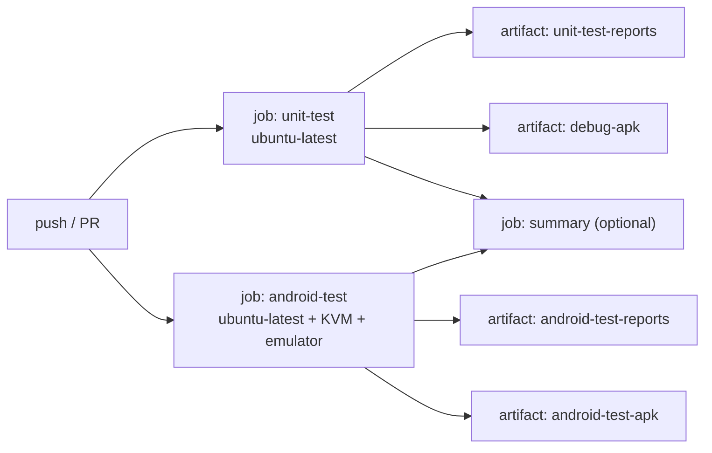

# テスト戦略

ステータス: 設計（未承認→親エージェントにより承認済み扱い）

関連: [requirements.md](requirements.md) / [data-model.md](data-model.md) / [architecture.md](architecture.md)

## 1. 前提

- ローカル開発環境は Google Maven / Maven Central に到達できず、Gradle のビルド・テストを実行できない。**GitHub Actions が唯一の検証手段**である。したがって (1) コンパイルエラーを出さないよう `architecture.md` 7 章の固定バージョンと保守的な API を使う、(2) テストは CI で失敗箇所が特定しやすいよう小さく分ける、(3) CI の成果物（レポート）を必ず上げる。
- 純Kotlin層（domain / markdown / data.mapper.PropertyValueCodec / Destination・Routes）は Android 依存がないため、JVM 上の JUnit4 で網羅的にテストする。

## 2. テスト階層

| 階層 | 場所 | 実行 | 対象 |
|---|---|---|---|
| (a) 単体テスト | `app/src/test` | JVM / JUnit4 | domain の型・ルール、Markdown パーサ、Codec、Routes/Destination |
| (b) ViewModel シナリオテスト | `app/src/test` | JVM / JUnit4 + kotlinx-coroutines-test + Fake リポジトリ | 各 ViewModel の状態遷移、画面遷移、複数画面にまたがる擬似操作シナリオ |
| (c) 実機テスト | `app/src/androidTest` | エミュレータ / AndroidJUnit4 | Room (in-memory) の DAO/リポジトリ、Compose UI の最低限の機能テストとシナリオテスト |

共有コード: `app/src/sharedTest/java` を `test` と `androidTest` の両方の Java ソースディレクトリに追加し、**リポジトリ契約テスト**（抽象クラス）を置く。JVM では Fake、実機では Room 実装に対して同一の契約を検証する。sharedTest は JUnit4 と kotlinx-coroutines-test のみに依存（Android API を使わない）。

## 3. ファイル構成と内容（固定）

パッケージ接頭辞 `com.amgm.notebook`。`T` = `app/src/test/java/com/amgm/notebook`、`A` = `app/src/androidTest/java/com/amgm/notebook`、`S` = `app/src/sharedTest/java/com/amgm/notebook`。

### 3.1 (a) 単体テスト

| ファイル | 主な検証 |
|---|---|
| `T/domain/model/ModelTest.kt` | ID の空文字拒否、`PropertyName` の trim 検証、`PropertyValue.Number` が非有限値を拒否、`matches(type)` |
| `T/domain/rules/TagHierarchyTest.kt` | 祖先/子孫、`isSubtypeOf`、ダイヤモンド継承、線形化順（名前順、祖先が先）、`wouldCreateCycle`（自己参照・間接循環）、`isInstanceOf`（自タグ/子孫タグ/無関係） |
| `T/domain/rules/EffectivePropertyResolverTest.kt` | data-model.md 3.4 の全ルール 14〜21: 継承収集、子の型上書き、位置保持、同型多重継承の統合(required OR)、異型多重継承の `PropertyConflict`、子による衝突解消、`resolveForTags` の複数タグ、定義順 |
| `T/domain/rules/NoteValidatorTest.kt` | TypeMismatch(ERROR)、RequiredMissing(WARNING)、Empty の扱い、自由プロパティは検証なし、Conflict(WARNING)、`hasErrors` |
| `T/domain/service/TableViewBuilderTest.kt` | 列=実効定義順、行=自タグ+子孫タグのノート、無関係タグ除外、複数タグ持ちノート、ソート（Empty末尾・型別比較・同値の安定性）、衝突の伝搬 |
| `T/markdown/MarkdownParserTest.kt` | 見出し1〜3と4以上、段落と LineBreak、太字/斜体/コード/ネスト、閉じ忘れ記号のリテラル化、エスケープ、コードブロック（言語・閉じ忘れ）、箇条書き、番号付き(開始番号)、引用(再帰)、水平線、非対応記法（リンク/画像/テーブル）が Text になること、任意入力で例外が出ないこと（ランダム/境界入力） |
| `T/data/mapper/PropertyValueCodecTest.kt` | 各型の往復（Double の境界、閏日、空文字 Text と Empty の区別）、未知 `value_type` と不正文字列が Empty になる |
| `T/ui/navigation/RoutesTest.kt` | `Routes.noteEdit(null/id)`、`Destination.route` が `Routes` 定数と整合、引数の取り出しキー |

### 3.2 (b) ViewModel シナリオテスト

テスト補助（`T/testutil/`）:

| ファイル | 内容 |
|---|---|
| `MainDispatcherRule.kt` | `TestWatcher`。`Dispatchers.setMain(StandardTestDispatcher/UnconfinedTestDispatcher)` と後始末 |
| `FakeNoteRepository.kt` | `MutableStateFlow<Map<NoteId, Note>>` ベース。`NoteRepository` を完全実装（検索・`observeNotesByTagIds`・未知 TagId 検査は `FakeTagRepository` を参照） |
| `FakeTagRepository.kt` | 同様。`save` で `TagHierarchy` による循環検出・名前重複・親不在を**本物と同じ例外**で拒否。`delete` で他タグの `parentIds` から除去し、`FakeNoteRepository` と連動してノートのタグリンクを除去 |
| `FixedClock.kt`, `SequentialIdGenerator.kt` | 決定的な時刻・ID（`id-1`, `id-2`…） |
| `TestData.kt` | ビルダ関数 `tag(...)`, `note(...)` |
| `FakeNavigator.kt` | `NavController` の代替。`UiEvent` を受けて `backStack: List<Destination>` を更新（`Navigate` で push、`NavigateBack` で pop）。`start = NoteList`。`collectFrom(viewModel.events)` 補助 |

契約テスト（`S/domain/repository/`）: `NoteRepositoryContract.kt`, `TagRepositoryContract.kt`（abstract class。`abstract fun createRepositories(): Pair<NoteRepository, TagRepository>` を持つ）。検証: save→observe の反映、更新、削除と cascade（ノート削除でリンク消滅、タグ削除でノートのタグ除去と子の親除去）、検索、`observeNotesByTagIds`、循環/自己参照/重複名/親不在の例外、タグ名の大文字小文字無視一意。JVM 側 `T/testutil/FakeRepositoriesContractTest.kt` が Fake を、実機側 `A/data/RoomRepositoriesContractTest.kt` が Room(in-memory) を対象に継承して実行する。

ViewModel 単体（状態遷移）:

| ファイル | 主なケース |
|---|---|
| `T/ui/notelist/NoteListViewModelTest.kt` | 初期ロード(`isLoading` true→false)、検索で絞り込み、一覧が更新日時降順、削除、`onNoteClick`/`onCreateNoteClick`/`onTagsClick` が正しい `Navigate` を発行 |
| `T/ui/noteedit/NoteEditViewModelTest.kt` | 新規作成の初期状態、タグ選択で定義済みプロパティ行が出現・外すと自由化、親タグの定義を継承して出現、型付き入力(Number/Date/Boolean)の解釈と `Unparsable`、必須未入力は WARNING のまま保存成功、型不一致は保存拒否(`SaveBlockedByErrors`, repository.save 未呼び出し)、自由プロパティの追加/削除/重複名、編集/プレビュー切替で `previewDocument` 更新、未保存で戻ると確認ダイアログ→破棄/継続、既存ノート読込・更新時に `updatedAt` が Clock 値・`createdAt` 保持、削除、存在しない ID |
| `T/ui/taglist/TagListViewModelTest.kt` | 一覧(親名・定義数)、削除確認フロー、各 `Navigate` |
| `T/ui/tagedit/TagEditViewModelTest.kt` | 新規/既存読込、親候補から自分と子孫が除外される、親トグルで `inheritedSchema` 更新、定義の追加/編集/削除/並べ替え、名前空・定義名空/重複エラー、循環登録の例外を `Cyclic` に変換（Fake に直接循環を仕込む）、重複名、保存成功で `NavigateBack` |
| `T/ui/tagtable/TagTableViewModelTest.kt` | 列=実効定義順、子孫タグのノートを含む、ノート追加/タグ変更に追従(Flow再発行)、ソート切替(昇順→降順→解除)、`onRowClick`→`NoteEdit`、存在しないタグ、衝突表示 |

シナリオテスト（複数 ViewModel + `FakeNavigator` + 共有 Fake リポジトリで画面操作を擬似）`T/scenario/`:

| ファイル | シナリオ |
|---|---|
| `TagTemplateScenarioTest.kt` | ① タグ「書籍」を作成（`price:Number required`, `author:Text`）→② 子タグ「電子書籍」(親=書籍)を作成→③ ノート作成で「電子書籍」を付与→継承された `price`/`author` 行が出る→④ 値を入力して保存→⑤ 「書籍」の表ビューに当該ノートが現れ、`price` 列に値が出る→⑥ 行タップでノート編集へ遷移 |
| `MultiTagConflictScenarioTest.kt` | 型の異なる同名プロパティを持つ2タグを親に持つタグを作成→衝突が `inheritedSchema` と `NoteEdit` の警告に出る→子で再定義して解消 |
| `CyclicInheritanceScenarioTest.kt` | A←B←C を作成→A の編集画面で親候補に B,C が出ない→Fake に直接 A.parent=C を保存しようとして `CyclicInheritance` メッセージ |
| `NavigationScenarioTest.kt` | `FakeNavigator` で `NoteList→TagList→TagTable→NoteEdit→戻る→戻る…` の全経路を辿り、バックスタックが `architecture.md` 4 章の遷移図と一致すること。保存/削除後の `NavigateBack` |
| `TagDeleteScenarioTest.kt` | タグ削除後、ノートのタグ消滅・プロパティ値は自由プロパティとして残る・子タグの親が減る |

規約: 各テストは `runTest` + `MainDispatcherRule`。ViewModel の `uiState` は `advanceUntilIdle()` 後に `.value` で検証。`events` は `backgroundScope.launch { vm.events.toList(list) }` 等で収集（`UnconfinedTestDispatcher` を使う）。テスト名は日本語バッククォートで可（`fun \`タグを付けると継承プロパティ行が現れる\`()`）。

### 3.3 (c) 実機テスト（エミュレータ）

| ファイル | 内容 |
|---|---|
| `A/data/RoomRepositoriesContractTest.kt` | 契約テストを Room(in-memory) で実行 |
| `A/data/NotebookDatabaseTest.kt` | 外部キー CASCADE、`tags.name` の NOCASE 一意制約、`replaceTag`/`replaceNote` のトランザクション、Codec を通した全 `PropertyValue` 型の往復 |
| `A/ui/NoteListScreenTest.kt` | （最低限の機能）起動して空状態表示、FAB でノート編集へ、保存後に一覧へ戻りタイトルが表示される、検索で絞り込まれる |
| `A/ui/NoteEditScreenTest.kt` | 本文入力→プレビュー切替で見出し/太字がテキストとして描画される（`NOTE_EDIT_PREVIEW` 内に期待テキスト）、タグチップ選択でプロパティ入力欄が出る |
| `A/ui/TagFlowScenarioTest.kt` | （シナリオ）タグ作成(定義付き)→ノート作成してタグ付与・プロパティ入力・保存→タグ一覧からタグを開いて表ビューに行と値が表示→行タップでノート編集に遷移→戻る |
| `A/ui/InheritanceScenarioTest.kt` | （シナリオ）親子タグ作成→子タグ付きノートの表を親タグの表ビューで確認 |
| `A/testutil/ComposeTestSupport.kt` | `fun createTestContainer(): AppContainer`（`NotebookDatabase.inMemory` + `DefaultAppContainer`）、`ComposeContentTestRule.launchApp(container)` = `setContent { NotebookApp(container) }`、テスト後に DB close |

方針: UI 要素は `TestTags`（architecture.md 9 章）で特定。アニメーションに依存しない。各テストは独立した in-memory DB を使う。実機テストは数を絞り（1テスト 30 秒未満目安）、CI のエミュレータ起動時間を考慮して最低限にとどめる。

## 4. GitHub Actions

ファイル: `.github/workflows/ci.yml`。トリガー: `push`（全ブランチ）, `pull_request`, `workflow_dispatch`。`concurrency: group: ci-${{ github.ref }}, cancel-in-progress: true`。

ビルドツールの扱い: Gradle Wrapper の jar をリポジトリに含められない場合に備え、CI は `gradle/actions/setup-gradle@v4`（`gradle-version: 8.9`）を使い、**`gradle` コマンドを直接呼ぶ**（`./gradlew` を使わない）。



### 4.1 job: `unit-test`

1. `actions/checkout@v4`
2. `actions/setup-java@v4`（`distribution: temurin`, `java-version: 17`）
3. `gradle/actions/setup-gradle@v4`（`gradle-version: 8.9`）
4. `gradle :app:testDebugUnitTest :app:assembleDebug --stacktrace`（(a)(b) を実行し APK を作る）。テスト失敗でも成果物をアップロードするため以降の upload は `if: always()`。
5. `actions/upload-artifact@v4`
   - name: `unit-test-reports` / path: `app/build/reports/tests/testDebugUnitTest`（HTML）と `app/build/test-results/testDebugUnitTest`（JUnit XML）
   - name: `debug-apk` / path: `app/build/outputs/apk/debug/*.apk`
6. `if: always()` で `$GITHUB_STEP_SUMMARY` にテスト件数を出力（任意）。

### 4.2 job: `android-test`

1. checkout / setup-java 17 / setup-gradle（上と同じ）
2. KVM 有効化（ubuntu-latest で必須）:
   ```
   echo 'KERNEL=="kvm", GROUP="kvm", MODE="0666", OPTIONS+="static_node=kvm"' | sudo tee /etc/udev/rules.d/99-kvm4all.rules
   sudo udevadm control --reload-rules
   sudo udevadm trigger --name-match=kvm
   ```
3. `reactivecircus/android-emulator-runner@v2`:
   - `api-level: 34`, `arch: x86_64`, `target: google_apis`, `profile: pixel_6`
   - `disable-animations: true`, `force-avd-creation: false`, `emulator-options: -no-window -gpu swiftshader_indirect -noaudio -no-boot-anim -camera-back none`
   - `script: gradle :app:connectedDebugAndroidTest :app:assembleDebugAndroidTest --stacktrace`
4. `actions/upload-artifact@v4`（`if: always()`）
   - name: `android-test-reports` / path: `app/build/reports/androidTests/connected`（HTML）と `app/build/outputs/androidTest-results/connected`（JUnit XML）
   - name: `android-test-apk` / path: `app/build/outputs/apk/androidTest/debug/*.apk`

### 4.3 成果物一覧

| アーティファクト名 | 内容 | 生成 job |
|---|---|---|
| `debug-apk` | アプリの debug APK (`app-debug.apk`) | unit-test |
| `unit-test-reports` | JVM テストの HTML レポートと JUnit XML | unit-test |
| `android-test-reports` | 実機テストの HTML レポートと JUnit XML | android-test |
| `android-test-apk` | 計装テスト APK (`app-debug-androidTest.apk`) | android-test |

保持期間は `retention-days: 14`。Actions の画面（Summary 下部の Artifacts）からダウンロードできる。

## 5. 実装者への注意（CI で壊れやすい点）

1. `sharedTest` ソースセットの追加は `android { sourceSets { getByName("test").java.srcDir("src/sharedTest/java"); getByName("androidTest").java.srcDir("src/sharedTest/java") } }`。Kotlin ファイルも `java` ディレクトリに置く。
2. 単体テストで `android.*` を呼ぶコード（`Log` など）を domain/markdown/ViewModel に入れない。必要なら `isReturnDefaultValues = true` に頼らず排除する。
3. Room の KSP 出力に依存するクラス（DAO 実装）は JVM 単体テストに含めない（実機テストでのみ検証）。
4. `ui-test-manifest` を `debugImplementation` に入れないと `createComposeRule` が失敗する。
5. エミュレータ起動に数分かかるため `android-test` の `timeout-minutes: 45` を設定する。
